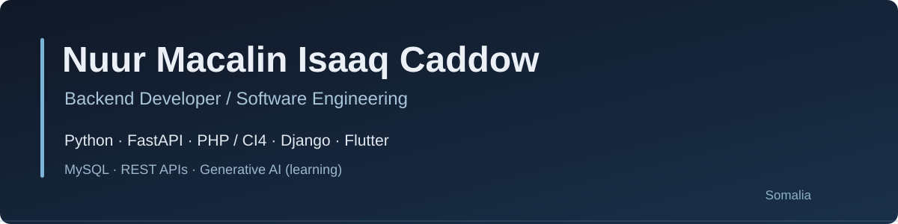

# Hello, I'm Nuur.

I'm a software developer based in Somalia. I focus on building reliable backend applications, clean APIs, and practical software. I enjoy understanding how systems work, from database design to the details of application logic.

### Technologies

**Backend:** Python, FastAPI, PHP, CodeIgniter 4  
**Also working with:** Django / Django REST Framework (basics), Flutter & Dart  
**Data:** MySQL, SQLite, SQLModel, SQLAlchemy  
**Development tools:** Git, GitHub, Postman

### Current interests

- Building well-structured REST APIs with validation, authentication, and database integration
- Improving software architecture, testing, and production-ready backend practices
- Developing mobile applications with Flutter
- Exploring LLMs, retrieval-augmented generation, and AI agents

### Selected work

**[FastAPI practice and projects](https://github.com/NuurMacalin/FastApi)**  
A collection of Python and FastAPI exercises and implementations, including CRUD APIs and data-validation patterns.

### Get in touch

[GitHub](https://github.com/NuurMacalin) · Based in Somalia

---

*Learning continuously. Building with purpose.*
